# Gospel Atlas

Four Gospel pixel maps, parallel passages and biblical cross-references, in one
self-contained HTML file. Every verse of Matthew, Mark, Luke and John is a
square on a map; click a square and you read that story as all four Gospels tell
it, side by side, in any of 21 languages.

No installation, no account, no server, no internet connection, no tracking.

**[Open it in your browser](https://mulibwangi.github.io/gospel-atlas/)** &nbsp;·&nbsp;
**[Download the offline edition](https://github.com/Mulibwangi/gospel-atlas/raw/main/download/Gospel_Atlas_David_Lee.zip)** &nbsp;·&nbsp;
[Reader's guide](GUIDE.md)

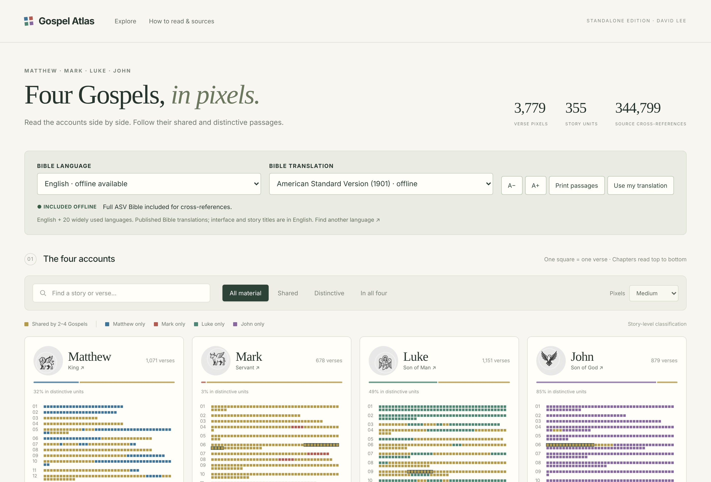

---

## What it does

**One square, one verse.** Each Gospel keeps its own order, chapter by chapter,
top to bottom. The shape of each book is its own: Mark short and dense, Luke
long, John largely distinctive.

**Colour shows who tells what.** Gold marks a story unit that the Composite
Gospel Index assigns to more than one Gospel. The four other colours mark units
assigned to Matthew, Mark, Luke or John alone, and the badges give the exact
combination. The colours describe the index, not an exact match of wording.

**Click to read.** Selecting a square or a story opens the parallel passages in
four columns, with the reference range for each Gospel and a plain note where a
Gospel has no parallel.

**See the order, not just the overlap.** "Show order" joins each shared story
unit across the four maps with a band. Level bands mean the Gospels agree on
where the episode sits; steep ones mean they do not — and the long diagonals
into John are the clearest statement of the problem any synopsis is trying to
address.

**Or line them up.** "Align parallels" rearranges the maps into synopsis order:
one row per story unit, every Gospel on the same row. The blank space becomes
the argument — Mark with nothing beside Matthew's and Luke's infancy
narratives, John's early Judean ministry standing alone, Matthew's Sermon block
with empty columns around it.

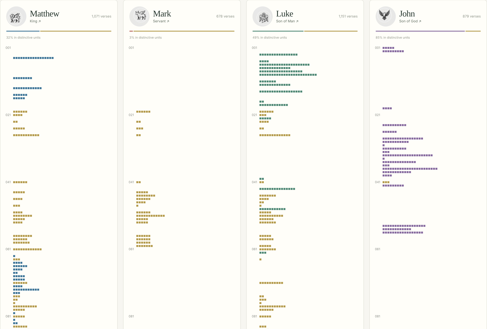

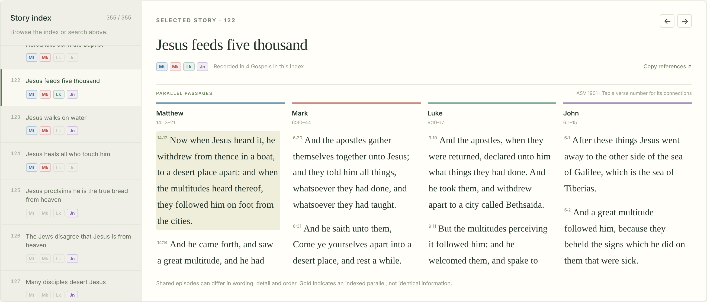

**Follow the cross-references.** Click a verse number to see where else in the
Bible it points — 44,469 links originating in the four Gospels, ordered by the
votes recorded in the OpenBible.info dataset. Those votes order the links; they
are not similarity scores.

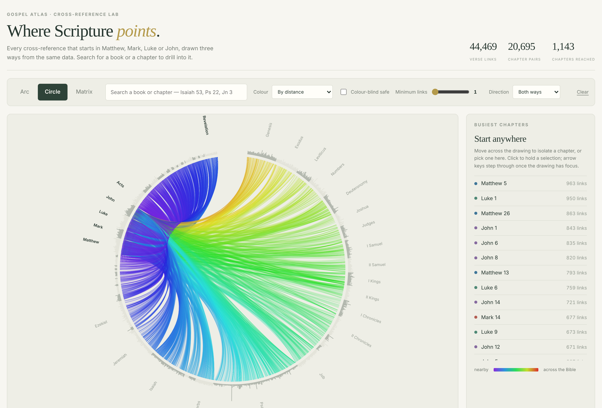

**The heading symbols open Scripture, not commentary.** Each Gospel carries an
icon — lion, ox, human figure, eagle — and clicking it shows the passages behind
that theme. This is the selected thematic arrangement; it differs from the
customary Matthew/human, Mark/lion, Luke/ox, John/eagle arrangement in Christian
art. The panels contain Scripture and references, with no generated commentary.

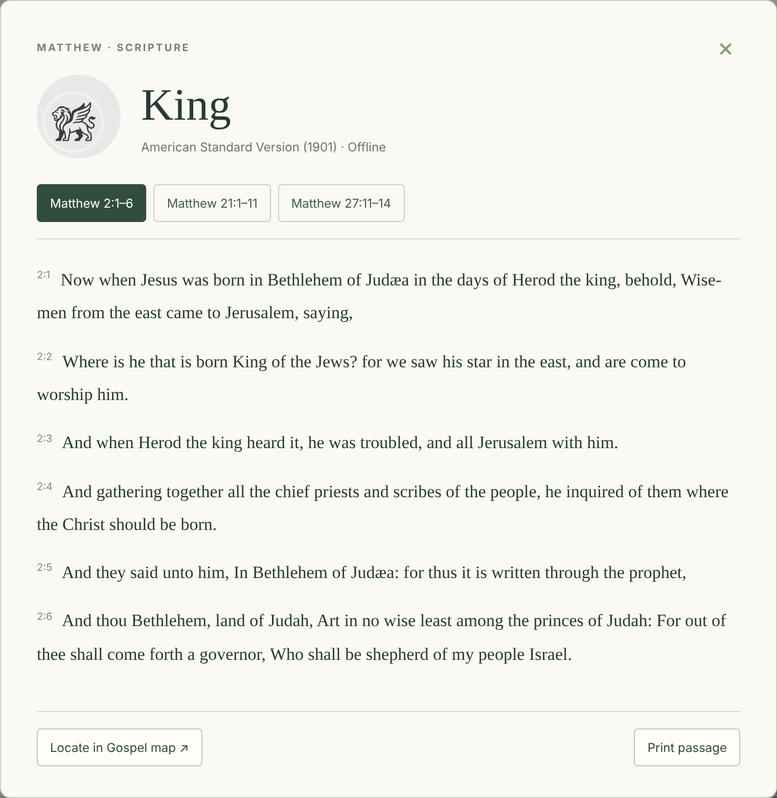

**Search the text, and compare the accounts.** The search box matches story
titles, references such as `John 4:7`, and the Scripture text itself in whatever
edition you are reading — accents and ligatures folded, so `Zacchaeus` finds the
ASV's `Zacchæus`. "Told in … but not in …" lists the units one Gospel records
and another does not, which is the comparison the maps show but cannot answer
precisely.

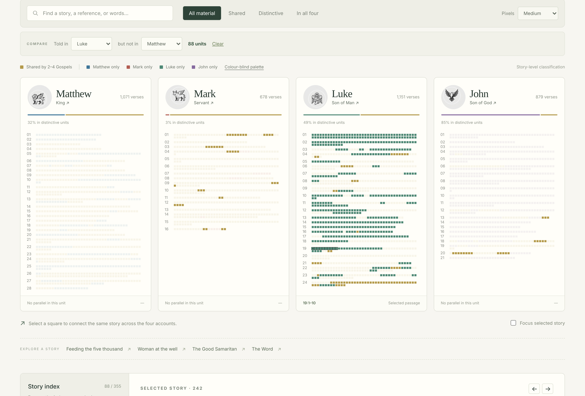

Adjust the text size, print the selected passages, copy the references, or
download the index, cross-reference and audit data from inside the app. Arrow
keys move through a map that has keyboard focus, and a colour-blind palette
(Okabe-Ito) is one click away in the legend. The address bar keeps the selected
story and verse, so a copied link reopens at the same passage.

## Cross-Reference Lab

A second page, `docs/cross-references.html`, draws the cross-references
themselves three ways — an arc diagram, a circle with the chords bundled by
book, and a matrix — switching between them without losing your place.


Choose a book or a section and the ring closes, turns it to twelve o'clock and
widens it to about a third of the circumference — a bezel, with every chord
radiating from it and the panel listing which other books it actually talks to.
Revelation sends 6,532 links across its boundary to 62 books: Isaiah 717,
Psalms 539, Matthew 450, Daniel 438, Ezekiel 394.

Click any of those links and the passages open underneath, verse by verse,
strongest first, with the ASV text on both sides — the same side-by-side
reading the Atlas gives for the Gospels.

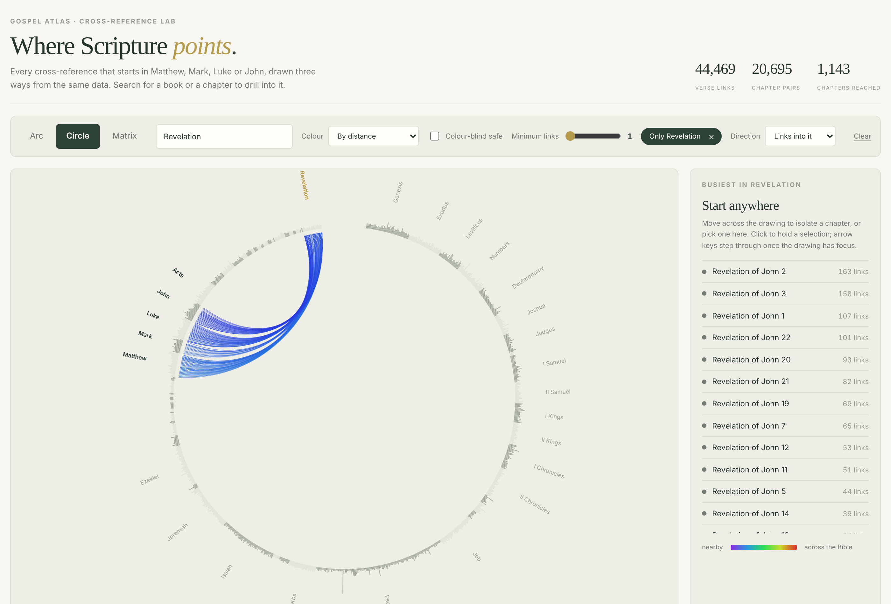

**Trace a thread.** Pick a thread and the field recedes to a wash while the
links that carry it are drawn in scarlet over the top. A link joins a thread
when the ASV text at **both** of its ends contains one of the thread's words —
so a thread is a word search, not a doctrine, and the page says so. The words
are yours to change.

The scarlet thread — blood, lamb, sacrifice, atonement, redeem, ransom,
offering, slain — runs through 6,525 of the 344,798 links, touching 485
chapters. Its heaviest chapters come out as Leviticus 4, Exodus 29, Hebrews 9,
Leviticus 7 and 16, Hebrews 10: the sacrificial system and the letter that
reads it. In the matrix the shape is unmistakable — a scarlet block over the
Torah, a scatter through the Prophets, and a bright band at the bottom left
where Revelation reaches back to Genesis and Exodus. The reading is old; what
is new is that you can watch the links either support it or fail to.

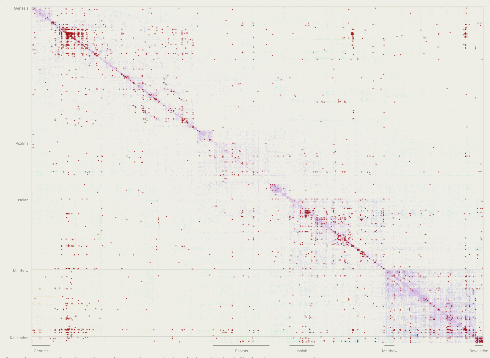

**Follow a chain.** The same menu offers a second kind of thread: a named list
of passages in canonical order rather than a word search. "Scarlet thread — the
passages" is the chain as it is usually told — the coats of skins, the ram in
the thicket, the scarlet cord on Zerah's hand, the blood on the doorposts, the
scarlet in the curtains and in the ephod, the life that is in the blood,
Rahab's line in the window and her rescue, Tamar in Matthew's genealogy, the
Lamb of God, "It is finished", and the letter to the Hebrews that reads all of
it backwards. Fifteen stations, numbered around the rim, drawn in order.

What the data decides is not the chain but each step of it. A step is drawn
solid where the dataset has a direct cross-reference between those two chapters
and dashed where it does not, and the page says how many. In the matrix each
step becomes a single cell — filled or outlined — so the whole chain is a
handful of marks you can check one at a time. Open any station to read the
verse.

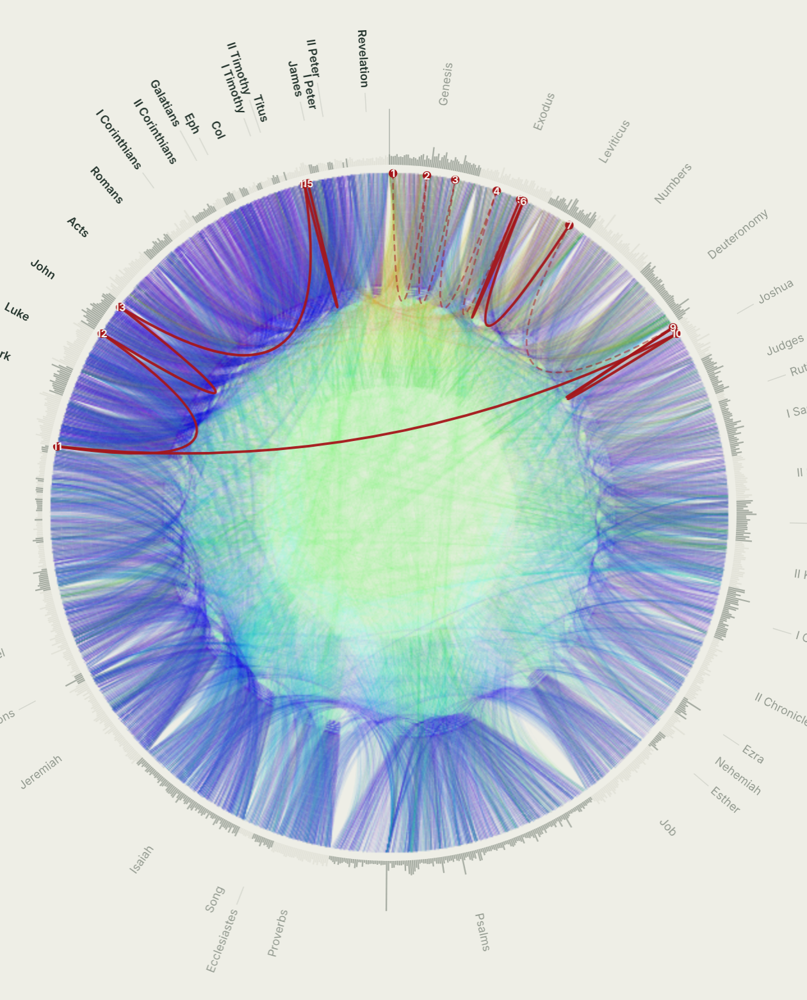

Seven chains ship with the page, and the interesting result is that they do not
all hold equally well:

| Chain | Stations | Steps attested |
| --- | --- | --- |
| The suffering servant | 16 | **15 of 15** |
| The Passover lamb | 13 | 11 of 12 |
| The seed promise | 17 | 13 of 16 |
| The kinsman-redeemer | 17 | 13 of 16 |
| The temple and the dwelling of God | 17 | 13 of 16 |
| Scarlet thread — the passages | 15 | 9 of 14 |
| The exchange — he was made sin | 12 | 8 of 11 |

The suffering servant is drawn entirely in solid line: Isaiah 42 through 53 and
then Matthew, Mark, Luke, John, Acts, Romans and 1 Peter, every consecutive
step already joined in the dataset. That chain is not an interpretation laid
over the cross-references; it *is* the cross-references. The scarlet thread is
the weakest of the six — Genesis 3 to Genesis 22 to Genesis 38 to the Passover
is a line the editors never drew — and the difference between those two
pictures, all solid against half dashed, is the thing worth looking at.

That is not a verdict on the readings. The OpenBible editors were marking
quotation and allusion, so a chain built on shared vocabulary scores well and
one built on typology scores badly almost by construction. What the page offers
is the distinction itself, drawn rather than argued.

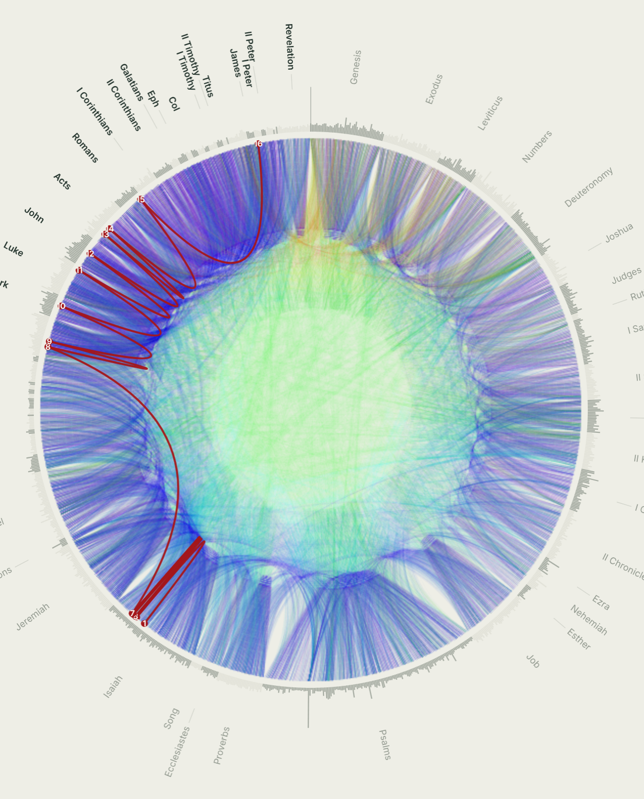

**Test a first mention.** The law of first mention says that a concept's first
occurrence in Scripture governs what follows, and that you should begin your
study there. Stated that way it is not a query — it is an assertion no dataset
can confirm. But a narrower claim sits inside it that the data can test: if the
first mention governs, *the later passages ought to point back to it*.

So the page splits the claim in two. You supply the claimed origin and the
passages that belong to the concept; both are readings and neither can be
computed. The data answers one question only — how many of those later passages
carry a cross-reference back — and reports where the weight of the set actually
falls. The origin sits at twelve o'clock with a spoke to every other passage:
solid where it is pointed back to, dashed where it is not. In the matrix the
origin's row is the claim and its column is what it points at, so the
asymmetry is visible: being cited is not the same as citing.

Four sets ship with the page, and they come out very differently:

| Concept | Claimed origin | Point back |
| --- | --- | --- |
| Marriage | Genesis 2:24 | **4 of 4** |
| The serpent | Genesis 3:1 | 4 of 5 |
| Blood | Genesis 4:10 | 2 of 9 |
| The widow and the fatherless | Genesis 21:17 | **1 of 18** |

Marriage is perfect because the New Testament quotes Genesis 2:24 outright —
Jesus in Matthew 19 and Mark 10, Paul in 1 Corinthians and Ephesians. Where
Scripture performs the law of first mention itself, the data records it.

Blood is the example usually given for the rule, and it is nearly the weakest
set here: Genesis 4:10 ranks 9th of the 10 passages in its own chain, and the
weight sits on John 1:29 and Hebrews 9:22. The serpent is the counter-case the
rule's own expositors raise — Genesis 3's serpent is satanic, but the serpent
lifted up in Numbers 21 is read as a type of Christ — and the data isolates it
exactly: four of the five later passages link back to Genesis 3, and the one
that does not is John 3:14.

The widow and the fatherless is the sharpest. Taking God's provision for Hagar
and Ishmael as the origin, **1 of 18** later passages links back to it, and the
one link that crosses between Genesis 21 and Exodus 22 runs the wrong way —
Genesis points forward, the law never points back. The weight of the whole set
is Isaiah 1:17, and the claimed origin ranks 11th of 19.

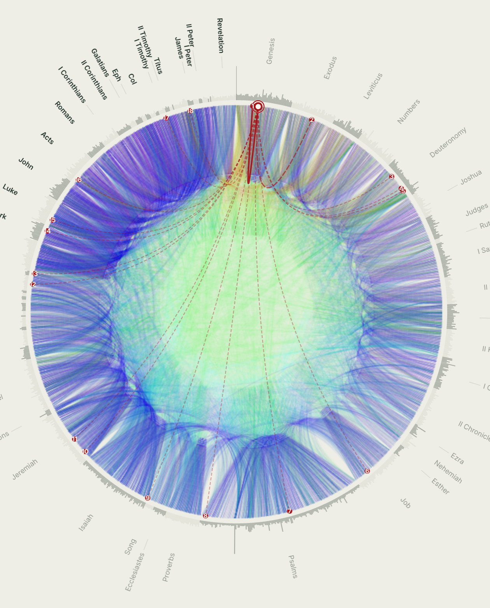

None of that refutes the readings. A low count says the connection is the
reader's rather than one the cross-reference editors marked — and since those
editors recorded quotation and allusion, a concept that precedes its own
vocabulary will always score low. "Widow" first appears at Genesis 38:11 and
"fatherless" at Exodus 22:22; a word search finds neither Hagar nor the point.
That gap between what a concept means and where its words begin is the reason
this is worth drawing rather than asserting.

The serpent set repays one more look, because the gap it leaves is not noise.
John 3:14's strongest link in the whole dataset is Numbers 21:7–9, the serpent
of brass, and Numbers 21:8 and 21:9 both point back at it — while John 3:14
touches Genesis 3 nowhere. The editors are treating these as two different
serpents, and the break falls exactly where the sign inverts: the emblem of the
curse becomes the means of healing. That inversion is what the chain **The
exchange — he was made sin** follows, from the fiery serpent on the standard
through Hezekiah breaking it in pieces to "him who knew no sin he made to be
sin on our behalf".

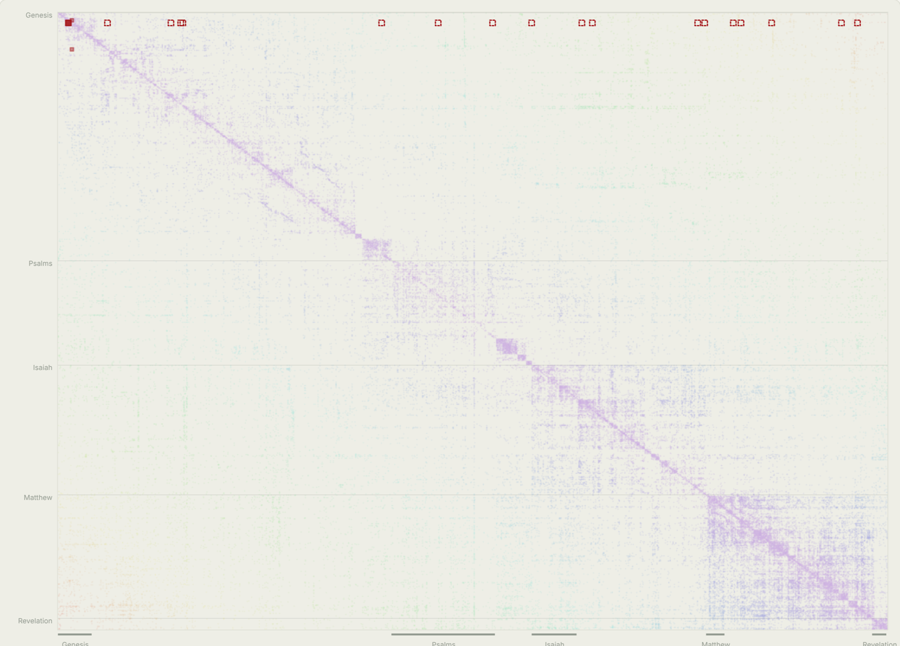

The matrix is the only one of the three that keeps direction, so the asymmetry
of the links is visible: who points at whom, rather than merely what is
connected. Search a book or a chapter (`Isaiah 53`, `Ps 22`, `Jn 3`, and the
usual abbreviations) to jump to it, or narrow the drawing to one book or to a
section — the Law, History, Wisdom and Poetry, the Major or Minor Prophets, the
Gospels, Paul's Letters, the General Letters, either Testament — and see only
what crosses into it, out of it, or both. That filter is what makes the density
usable: choose the Major Prophets and the picture becomes the few hundred
chords that actually land there, with Isaiah 53 at the head of the list.


It carries the complete dataset — **344,798 cross-references** over **191,620
directed chapter pairs**, reaching every one of the Bible's 1,189 chapters —
together with the full ASV text, so every link can be read rather than only
counted. One link is left out: it starts at 3 John 1:15, a verse the ASV does
not have. The
wash is built progressively, so the page is usable in under a second and fills
in as it draws. The minimum-links slider starts at 2, because two thirds of all
chapter pairs rest on a single verse link; drop it to 1 for everything.

Ask it a question and it answers from the data. Select Acts 27, Paul's
shipwreck, and among its links sit **Jonah 1** and **Psalm 107** — the storm at
sea and "they that go down to the sea in ships" — surfacing from vote-ordered
cross-references with nothing in the page that knows what the chapter is
about.

## Languages

English plus 20 widely used languages. This is a practical selection, not a
claim about an exact worldwide language ranking.

**Included in the file, readable offline** — English (ASV 1901 and the World
English Bible), Arabic (Van Dyck), Chinese (Union Version), French (Louis
Segond), German (Luther), Hindi (IRV), Japanese (Kougo), Portuguese (Bíblia
Portuguesa Mundial), Punjabi (IRV), Russian (Synodal), Spanish (Reina-Valera
1909) and Tamil (IRV).

**Opened through an online reader** — Bengali, Marathi, Telugu, Indonesian,
Korean, Swahili, Turkish, Urdu, Vietnamese, and English ESV, NASB 2020 and NASB
1995. These buttons open Bible Gateway or YouVersion and need an internet
connection; those copyrighted texts are not included in the file.

You can also load your own translation from a JSON file. It stays in your
browser for that session only: nothing is uploaded, stored or built into the
shareable file. The format is in the [reader's guide](GUIDE.md).

The ASV includes the full Bible, so cross-references outside the Gospels can be
read. Where a cross-reference falls outside an included book, the panel labels
its English ASV text explicitly. Missing verses are labelled and never silently
substituted. Scripture is not machine-translated. The interface and the story
titles are in English.

## Getting it

| | |
|---|---|
| **Use it now** | [mulibwangi.github.io/gospel-atlas](https://mulibwangi.github.io/gospel-atlas/) — the same app, hosted. Nothing to download. |
| **Keep a copy** | [Download the ZIP](https://github.com/Mulibwangi/gospel-atlas/raw/main/download/Gospel_Atlas_David_Lee.zip) (5.4 MB), unzip it, and double-click **1 START HERE - Open Gospel Atlas.html**. It works with no internet connection afterwards. |

The download holds four files: the START HERE page with its Open button, the
same instructions in plain text, the app itself, and the reader's guide. Nothing
opens from inside a ZIP preview window or an email attachment preview, so save
and unzip the download first. Use a recent Chrome, Firefox, Edge or Safari on
Windows, macOS or Linux, with JavaScript enabled. The app file is large, so
allow it a few seconds to appear.

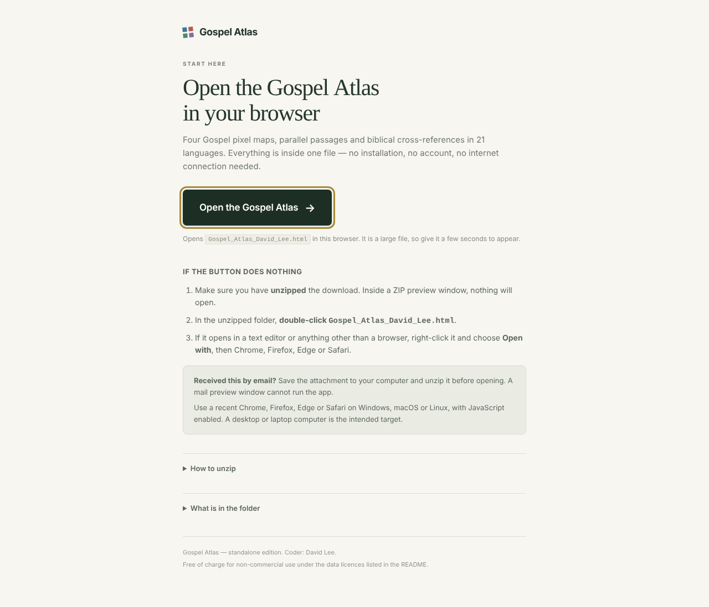

On a phone, use the hosted version: the maps become one Gospel per screen,
swiped sideways, and the parallel passages do the same. A downloaded ZIP is
awkward to open on a phone, whatever the app does.

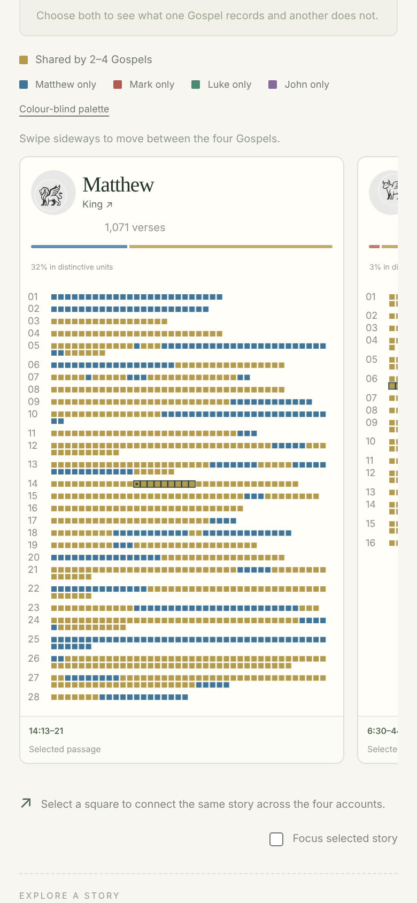


The complete collection may be shared free of charge for non-commercial use
under the data licences below.

## Building it yourself

Node.js 20 or later:

```sh
npm ci
npm run build
```

`dist/` then holds the app, the launcher, the plain-text instructions, the guide
and the ready-to-send ZIP. The data the build needs is all in `data/`; nothing
is fetched from the network, and the resulting app makes no network requests of
its own. Checks:

```sh
python3 verify_release.py     # verse counts, numbering, licences, no remote assets
node test_functions.mjs       # symbol mapping, ranges, import validation, links
```

| Path | |
|---|---|
| `src/` | The React application, the launcher page and the plain-text instructions |
| `data/` | The prepared index, cross-references, baseline text and translations |
| `source-data/` | Original Hindi, Tamil and Punjabi files, kept for the numbering checks |
| `build.mjs` | Bundles everything into one HTML file and assembles the ZIP |
| `zipwriter.mjs` | Dependency-free ZIP writer, so no `zip` command is needed |
| `docs/` | The copy published through GitHub Pages |
| `GUIDE.md` | The reader's guide shipped alongside the app |
| `SOURCE_README.md` | Build notes |

`prepare_languages.py` re-downloads the translation inputs and needs internet
access; the build does not use it. Three mirrors with ambiguous verse numbering
were deliberately left out of the offline set, and those languages use online
readers instead — `verification.json` records which, and why.

## Sources and permissions

The application source in `src/`, `build.mjs` and the helper scripts is MIT
licensed. The data carries its own licences, which travel with it, and the
non-commercial restriction on the Composite Gospel Index applies to the complete
app. Full notices, adaptations and source hashes are in [GUIDE.md](GUIDE.md) and
[LICENSE](LICENSE).

- **Composite Gospel Index 1.2** — Sean Boisen / [SemanticBible](https://semanticbible.com/cgi/cgi-view.html),
  [CC BY-NC-SA 2.0](https://creativecommons.org/licenses/by-nc-sa/2.0/). 355 units
  over 3,779 Gospel verses, here expanded to verse level and colour-classified.
- **Cross-references** — [OpenBible.info](https://www.openbible.info/labs/cross-references/),
  CC BY, snapshot of 26 October 2026. 344,799 records ingested; the 44,469
  originating in the Gospels are included.
- **ASV 1901** — public domain, via [scrollmapper/bible_databases](https://github.com/scrollmapper/bible_databases).
- **World English Bible and seven further public-domain editions** — [Free.Bible](https://free.bible/developers/).
- **Japanese Kougo 1954/1955** — public domain, structured text via scrollmapper.
- **Indian Revised Version** (Hindi, Punjabi, Tamil) — © Bridge Connectivity
  Solutions Pvt. Ltd., [CC BY-SA 4.0](https://creativecommons.org/licenses/by-sa/4.0/).
  Gospel extracts and formatting contributions retain that licence separately.
- **React** — MIT, © Meta Platforms, Inc. and affiliates. The licence notice is
  embedded in the built file.
- **Icon artwork** — supplied by David Lee.

No source publisher's endorsement is implied. No machine translation was used.

## Privacy and compatibility

The app has no account, no analytics and no remote scripts, and its content
security policy blocks background network connections. Only links you click
yourself open an outside service. A modern browser with `DecompressionStream`
support is required; older browsers are shown an update message instead. This
release was checked in a Chromium browser — native Windows, macOS and other
browser testing has not been carried out, so compatibility there is designed
rather than claimed.

---

Coder: **David Lee**. Issues and corrections are welcome through the
[issue tracker](https://github.com/Mulibwangi/gospel-atlas/issues).
